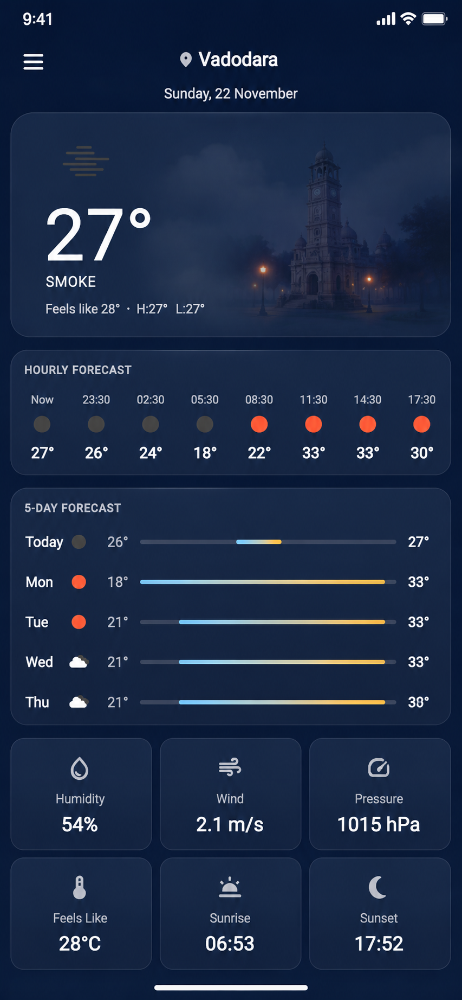

# Weather Forecast Application

A mobile weather application built with Flutter and Dart that provides real-time weather information and forecasts using the OpenWeatherMap API.

## Features

- Real-time weather information
- Location-based weather search
- Temperature and weather condition display
- Humidity information
- Weather forecast data
- Simple and user-friendly mobile interface
- API-based weather data integration

## Technologies Used

- Flutter
- Dart
- OpenWeatherMap API

## Project Structure

```text
weather_app/
├── android/
├── ios/
├── lib/
├── test/
├── web/
├── windows/
├── pubspec.yaml
└── README.md
```

## 📱 App Screenshots

### Weather Forecast App – Mobile Preview


